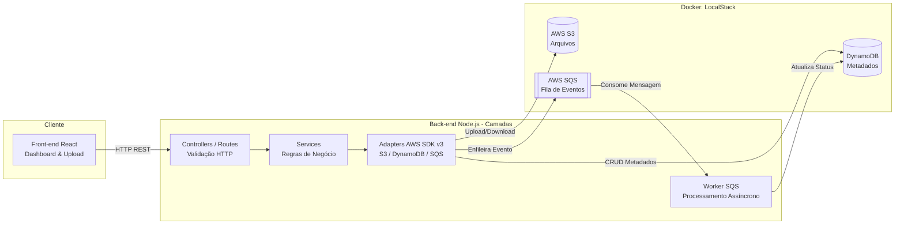

# Arquitetura do Sistema — CloudVault

Decisão registrada em [ADR-001](adr/ADR-001-arquitetura-camadas-localstack.md).

## Diagrama de Blocos

## O que o diagrama não diz
Conforme Sommerville (2019, p. 149–150), o diagrama de blocos mostra a estrutura macro e o fluxo principal, mas não especifica:
* Os contratos exatos de dados (schemas JSON das requisições, respostas e mensagens da fila SQS).
* O tratamento de falhas e estratégias de rollback (ex.: o que ocorre se o S3 gravar o arquivo e o DynamoDB falhar).
* Detalhes de concorrência, limites de tamanho de arquivo (10 MB) e latência máxima (RNF-01).
* Políticas de autenticação, CORS e variáveis de ambiente.
* Que o worker também passa pela camada de Adapters (e não acessa o SDK diretamente) — a seta `WRK → DDB` é simplificação.
